# Алгоритм сопровождения клиента КазИнфоТех

> **Черновик, составлен 9 ноября 2026 года, SMS-ветка дополнена 11 ноября. Требует утверждения владельцем процесса.** В Notion нет источников со статусом «Актуально»; страницы непроверены. Это рабочая сборка, не утверждённый регламент.

**Цель:** провести новое или действующее обращение по подходящей ветке и довести его до проверенного подключения либо до зафиксированного следующего шага. Охват — от первого обращения до передачи клиенту и закрытия. Подробная работа клиента в iWaba после подключения остаётся в профильных инструкциях.

## Уверенность

- **Подтверждено ≥2 источниками** — правило есть минимум в двух страницах.
- **Один источник** — найдено в одной странице.
- **Противоречие** — версии расходятся или актуальный вариант не установлен.

URL, статус, даты создания/правки каждой страницы — в [аудите источников](sources-audit.md). «Черновик» и «На проверке» не означают утверждённость.

## Ограничения

- Не называйте цену, тариф, лимит или срок теста по памяти. Перед ответом клиенту и оформлением проверьте действующие условия для выбранного маршрута.
- Не обещайте одобрение Meta, отображение имени или точную дату проверки.
- Не запрашивайте/не записывайте пароли, коды и токены. Если инструкция требует переслать секрет, используйте только утверждённый защищённый процесс; если его нет — остановитесь и уточните.
- Не запускайте массовую отправку без согласия получателей.
- Не представляйте личный WhatsApp/QR как официальный WhatsApp Business API.
- «Короткие номера» не найдены в базе: не обещайте и не создавайте рабочий маршрут.
- Не создавайте повторную заявку, пока текущая обрабатывается.

## Версия 2: продажи и подключение в одном маршруте

К алгоритму добавлены квалификация, КП, работа с возражениями, follow-up, причины потерь, тест с критерием успеха и активация. Эти практики продаж предложены для проверки владельцем процесса. После упрощения интерактивное дерево содержит 43 узла.

**Порядок:** обращение → выявление задачи → квалификация и выбор услуги → КП и реакция клиента → тест и договор → подключение → активация → закрытие. SMS по Казахстану и международные SMS идут по разным правилам: для зарубежных направлений доступны только платные Sender ID, без общих заголовков и локальных альфа-имён.

## 1. Принять обращение

**Заметка менеджеру.** Сначала проверьте историю в CRM и выясните, новый это клиент или действующий. Запишите компанию, контакт, тему обращения и следующий шаг.

**Цель и действия.** Ответить в канале клиента, найти карточку/историю в CRM, записать компанию, контакт, тему и следующий шаг. Для действующего клиента восстановить продукт, настройки и незавершённые задачи.

**Скрипт первого обращения** (дословно):

> Здравствуйте, [имя]! Меня зовут [имя], компания КазИнфоТех. Спасибо за обращение. Чтобы предложить подходящий вариант и учесть ваш сценарий, можно я задам несколько коротких вопросов? Это займёт около 3–5 минут.

Если клиент занят:

> Конечно, понимаю. Когда вам будет удобно вернуться к разговору? Могу также отправить короткий список вопросов, чтобы подготовить ответ заранее.

Для действующего клиента:

> Подскажите, пожалуйста, по какому продукту вы обращаетесь и что произошло? Я проверю историю и текущие договорённости, чтобы не просить вас повторять уже известные детали.

**Развилка.** Новый клиент → определить, с чего он начал, затем выявить потребность. Действующий → восстановить контекст: проблема с подключённой услугой → специалист; новая услуга → выявить потребность; оплата/документы → бухгалтерия; недовольство → выяснить причину; другое → назначить владельца уточнения и дату.

**Что нужно от клиента:** компания, контакт, описание задачи; при действующем подключении — продукт и наблюдаемая проблема, без секретов. **Команда:** проверить историю, при проблеме назначить специалиста. **Завершение:** тип обращения записан, следующий шаг назначен.

**Источники:** [Скрипты для менеджеров](https://app.notion.com/p/400488a74e6c81758d41e1804efadee5) — «На проверке», правка 2026-10-21; [Работа в команде в Bitrix24 CRM](https://app.notion.com/p/a8a3fc0eb8224640a615a06a5c69b770) — «Черновик», 2026-10-15; [доска](board.csv). **Уверенность:** ≥2 по новой/повторной заявке и восстановлению контекста; один источник по полям CRM.

## 2. Выявить потребность и подтвердить задачу

**Заметка менеджеру.** Задавайте только вопросы, которые помогают определить сценарий. Не предлагайте продукт до того, как клиент подтвердит краткое резюме задачи.

**Цель:** собрать достаточно сведений для выбора и подтвердить, что менеджер верно понял задачу. Пока клиент не подтвердил резюме — продукт не выбирать. В интерфейсе вопросы и подтверждение собраны в одной карточке: подтверждённая задача ведёт к квалификации; поправки возвращают к вопросам; занятость или пауза — к плану касаний.

**Вопросы** (дословно из «Скриптов для менеджеров», задавать только нужные):

1. «Для чего вы планируете отправлять сообщения: коды подтверждения, статусы заказа, напоминания, рассылки или ответы клиентам?»
2. «Кто обычно начинает диалог — ваша компания или клиент? Нужно ли писать клиенту первым?»
3. «Какой примерно объём сообщений в месяц и бывают ли сезонные пики? Если удобно, разделим его по сценариям: коды, уведомления, акции, поддержка».
4. «Клиенты находятся только в Казахстане или есть другие страны? Сейчас используете SMS, WhatsApp или оба канала?»
5. «Как вы решаете эту задачу сейчас? Что хотелось бы улучшить в первую очередь: стоимость, доставку, скорость запуска или удобство работы команды?»
6. «Сообщения будут отправляться вручную из кабинета или автоматически из сайта, CRM, 1С либо приложения? Есть ли предпочтительный способ интеграции?»
7. «Сколько сотрудников будут отвечать клиентам? Нужны ли общая история переписки, распределение диалогов и контроль обращений?»
8. «Это ваши действующие клиенты, которые согласились получать сообщения? Как вы фиксируете согласие и отписки?»
9. Для WhatsApp: «У вас уже есть номер для бизнеса? Он подключён к WhatsApp Business, к личному WhatsApp или это новый номер?»
10. «К какой дате решение желательно запустить? Кто ещё будет участвовать в согласовании — например, специалист по интеграции или руководитель?»

**Если клиент сразу спрашивает цену:** не откладывайте ответ и не называйте цифру по памяти. Объясните, что цена зависит от страны/оператора, типа сообщений, объёма и интеграции, задайте три коротких вопроса и проверьте действующий прайс.

> Понимаю, что цена важна. Подскажите, пожалуйста: какие сообщения планируете отправлять, какой ожидается объём и в какие страны? После этого сверю актуальный прайс и назову подтверждённые условия.

**Квалификация перед выбором канала (практика продаж, требует проверки):** оцените потребность, объём, срок, лицо, принимающее решение, и бюджет — по одному баллу. 4–5 баллов: переходите к выбору канала. 2–3: уточните недостающие пункты и продолжайте. 0–1 или клиент пока не готов: запишите причину паузы и согласуйте дату полезного касания. Эта оценка — следующий узел дерева после подтверждения задачи.

> Чтобы не возвращаться к одним и тем же вопросам, уточню только то, чего пока не хватает: кто участвует в решении, к какой дате нужен запуск и какой бюджет или текущие расходы вы рассматриваете?

**Копируемое начало диалога:**

> Чтобы предложить подходящий вариант, уточню несколько деталей о задаче, канале и объёме. Можете отвечать только на те вопросы, которые относятся к вашему сценарию; неизвестные пока пункты я отдельно отмечу и проверю.

Для SMS уточнить тип, географию, бренд/домен, текст-пример без персональных данных, SenderID и интеграцию. Не определять трафик только по регистрации компании. Для WhatsApp выяснить владельца номера, инициатора диалога, источник контактов и согласие.

**Клиент даёт:** относящиеся к задаче ответы. **Команда:** при неясной классификации SMS или интеграции сверяет маршрут со специалистом до рекомендации услуги. **Завершение:** цель, канал, объём/география, тип сообщений, интеграция, согласие и срок известны или пробелы записаны.

**Источники:** [Скрипты](https://app.notion.com/p/400488a74e6c81758d41e1804efadee5) — «На проверке», 2026-10-21; [Консультация клиента SMS](https://app.notion.com/p/3d6488a74e6c80eeab6aff42280a299b) — «Черновик», 2026-10-21; [iWabaKit — Заметки менеджеру](https://app.notion.com/p/40c488a74e6c81c7a682dbce5cb47911) — «На проверке», 2026-11-02. **Уверенность: ≥2 источников.**

## 3. Выбрать продуктовую ветку

**Заметка менеджеру.** Сначала подтвердите резюме задачи, затем ведите клиента по выбранной ветке услуги. Технические вопросы уточняйте внутри соответствующего продуктового маршрута; нестандартный путь передавайте специалисту до обещания возможностей или сроков.

Сначала прочитать клиенту резюме (дословно из базы):

> Спасибо, я записал(а). Правильно ли понимаю: вам нужно [цель], примерно [объём] сообщений в [период], для клиентов в [страны]. Сообщения будут [инициировать диалог / отправляться в ответ], а запускать их нужно через [канал или система]. Для вас особенно важно [приоритет]. Всё верно?

Если клиент не подтвердил резюме или задача не ясна — вернуться к этапу 2, уточнить спорные пункты и повторить резюме. До подтверждения продукт не выбирать.

**Канал:**

- **SMS:** сначала выбрать локальный, международный или смешанный трафик; затем уточнить имя отправителя и способ отправки — кабинет или API. Подробная SMS-ветка и материалы: [раздел 6.1](#61-sms-ветка).
- **WhatsApp:** выяснить, нужен общий кабинет/командная работа/CRM, самостоятельное подключение номера или API/серверная интеграция.
- **SMS + WhatsApp:** сначала пройти SMS-развилки, затем отдельно выбрать маршрут WhatsApp и зафиксировать действия по каждому каналу.
- **Короткие номера/иная неописанная услуга:** GAP, без обещания продукта.

**Рабочая маршрутизация WhatsApp:**

- Самостоятельное подключение официального номера в кабинете плюс общие диалоги/CRM → предварительно FlowZap.
- API/серверная интеграция, OTP или автоматизация из системы клиента → предварительно iWabaKiT, сценарий специалисту.
- Личный номер, QR, Coexistence или иной нестандартный путь → не называть подтверждённым официальным маршрутом, согласовать со специалистом.
- Несовпадение сценария с описанием продукта → передать специалисту до рекомендации или настройки.

**FlowZap — скрипт клиенту:**

> По вашему сценарию предварительно проверю подключение через кабинет FlowZap. Чтобы подтвердить подходящий вариант, уточню тип номера и требования к работе команды. Условия теста и подключения сверю до оформления.

**iWabaKiT — скрипт клиенту:**

> Для автоматизации через API я передам технический сценарий специалисту: [система], [событие отправки], [тип сообщений]. После проверки сообщу, подходит ли подключение iWabaKiT и какие данные потребуются. Пароли и токены отправлять не нужно.

**SMS + WhatsApp — скрипт клиенту:**

> Я отдельно проверю параметры SMS и WhatsApp, поскольку у каналов разные настройки и условия. Подскажите, пожалуйста, какие сообщения вы планируете отправлять через каждый канал? После уточнения проверю порядок и актуальные условия.

**QR, Coexistence или неясный сценарий — скрипт клиенту:**

> Для вашего сценария WhatsApp нужно подтвердить подходящий способ подключения. Я уточню требования у специалиста и сообщу результат до [дата/время]. Пока не буду называть QR официальным WhatsApp API или обещать доступность функции.

**Короткие номера — скрипт клиенту:**

> Запрос по коротким номерам получил(а). Я уточню у ответственного, есть ли утверждённый порядок подключения, и сообщу результат до [дата/время]. Пока не буду обещать условия или сроки.

Это рабочее разграничение, не утверждённая классификация: FlowZap в базе описан и как официальный WhatsApp через кабинет, и как командная среда с CRM; требования Meta для разных типов проверки смешиваются. См. [расхождения](conflicts-and-gaps.md), пункты 1, 2 и 6.

**Завершение:** клиент подтвердил потребность и канал; ветка услуги выбрана либо отмечена как требующая технического/внутреннего подтверждения.

**Источники:** [Алгоритм сопровождения клиента — Flowchart и скрипты менеджера](https://app.notion.com/p/40e488a74e6c81a78404cf94cf67c93d) — вне базы, правка 2026-11-04; [Скрипты](https://app.notion.com/p/400488a74e6c81758d41e1804efadee5); [Flowzap — Возможности](https://app.notion.com/p/856b5a6a04d94a98b232a3a6464370eb); [Обучение новых сотрудников](https://app.notion.com/p/821ecf6656a24d999b7ca97262996dbf) — «Черновик», 2026-10-21; [WABA и Coexistence](https://app.notion.com/p/3ff488a74e6c814ba95befcdcc0945e2). **Уверенность:** ≥2, что задачу надо подтвердить; противоречие/владелец должен подтвердить точный маршрут WhatsApp.

## 4. Подготовить и отправить КП

**Заметка менеджеру.** Отправляйте предложение после подтверждения задачи и выбора маршрута. Используйте действующий прайс и указывайте только подтверждённые сроки и условия. Шаблон КП, диапазоны цен и срок действия предложения должен утвердить владелец процесса.

Перед отправкой проверьте, что в КП есть:

- короткое резюме задачи клиента;
- выбранный канал и продукт, объём и география;
- подтверждённая стоимость и условия теста, если он нужен;
- действия клиента и команды;
- один следующий шаг и дата обсуждения.

**Скрипт для копирования:**

> Отправляю предложение по вашей задаче: [краткое резюме]. В нём указаны маршрут [продукт/канал], объём [объём], подтверждённые условия и следующие действия. Давайте обсудим вопросы и решение [дата/время]. Если предложение согласуют коллеги, подскажите, кого подключить к обсуждению.

**После отправки выберите продолжение:**

- Клиент согласен → этап 5, тест и договор.
- Есть возражение → выслушайте, подтвердите важность вопроса, уточните причину и ответьте подтверждённым фактом. Готовые скрипты по цене, срокам, поставщику и доверию — в узле «objection-handle».
- Клиент думает или не отвечает → назначьте касания на 1, 3, 7, 14 и 30 день. Для каждого касания подготовьте полезный повод; последний контакт — без давления.
- Клиент отказался → выберите одну причину в CRM и согласуйте дату возврата, если клиент не против.

Новые практики по квалификации, возражениям и срокам follow-up требуют проверки руководителем. Не обещайте скидку, доставку или дату запуска без подтверждения.

## 5. Решить вопрос о тесте и договоре

**Заметка менеджеру.** До оформления отдельно подтвердите, нужен ли тест и какие условия применимы к выбранному продукту. Собирайте только нужные для оформления данные, не просите секреты.

**Тест.** Уточните, нужен ли он и для какого продукта. До старта согласуйте критерий успеха, объём и срок, ответственного со стороны клиента и дату подведения итогов. Запрашивайте данные для тестового доступа только если они необходимы выбранному продукту и предусмотрены утверждённой формой.

- SMS — тест по продуктовой инструкции, условия подтвердить до обещания клиенту.
- iWabaKiT — отдельный тестовый сценарий с ограниченным доступом/балансом; срок подтвердить у ответственного.
- FlowZap — условия для WABA, QR и создания через FLUI различаются или описаны не полностью; проверить карточку/условия. Не сообщать срок QR без проверки.
- Бонус менеджера за тест не обещать: материалы связывают тип доступа «тестовый» с отсутствием бонуса, применимость по продуктам надо подтвердить.

**Скрипт о тесте:**

> Нужен ли вам тестовый доступ перед запуском? Я проверю условия именно для [продукт] и сообщу порядок, срок и необходимые действия после подтверждения у ответственного.

**Договор.** Если нужен, отправить форму реквизитов, проверить сгенерированный документ и согласовать подписание. Собирать только данные для договора/теста, не секреты.

**Скрипт:**

> Уточните, пожалуйста, каким способом вам будет удобнее подписать договор:
> - подписать оригиналы и передать их по почте или через водителя (в городе Алматы);
> - подписать удалённо с использованием ЭЦП через ЭДО (мы загрузим договор, вам останется лишь подписать);
> - отправить скан подписанного договора в формате PDF?

ЭДО, бумажная доставка или PDF-скан — только в рамках действующей инструкции. Если способ неясен, уточнить у ответственного.

**Клиент даёт:** нужные реквизиты и выбранный способ. **Команда:** проверяет документ, выполняет внутреннюю передачу. **Завершение:** тест создан/не нужен, договор и подпись завершены либо следующий шаг записан.

**Источники:** [Тестовый доступ SMS](https://app.notion.com/p/3d6488a74e6c80d6a8d1ebbc6ccf1280) — «Черновик», 2026-10-15; [Тестовый доступ WhatsApp/IWABA](https://app.notion.com/p/3e4488a74e6c805f9e88cddbd0821854) — «Черновик», 2026-10-21; [Как завести клиента во FlowZap](https://app.notion.com/p/3fa488a74e6c81168f3dfee6889dd37d) — «Черновик», 2026-10-21; [Подготовка договора](https://app.notion.com/p/3d7488a74e6c806c912ae5d495403095) — «Черновик», 2026-10-15. **Уверенность:** противоречие по FlowZap; ≥2 по способам подписи; один источник по процедурам теста.

## 6. Подключить, проверить, при ошибке передать специалисту

**Заметка менеджеру.** Для комбинированного запроса отдельно выполните процедуры обеих услуг. Проверьте тест по согласованному сценарию; при ошибке передавайте специалисту сведения без паролей, кодов и токенов.

**Сообщение клиенту:**

> Переходим к подключению [услуга]. Со своей стороны мы выполним [действия команды], от вас потребуется [действия клиента]. После настройки проверим [тестовый сценарий]. Доступы и подтверждения вводите только самостоятельно в официальном кабинете; пароли и коды в чат отправлять не нужно.

- **SMS:** выполнить порядок ниже. Старые тарифы и числа со скриншотов не использовать для расчёта.
- **FlowZap:** заведение компании и подключение номера — по процедурам FlowZap/FLUI; разделять официальный WABA и QR.
- **iWabaKiT/WhatsApp API:** клиент сам проходит вход и подтверждения Meta; менеджер проверяет статус карточки канала. Администраторские действия выполняет только уполномоченный сотрудник.
- **Интеграция:** передать специалисту сценарий, систему и ожидаемый результат утверждённым способом. Доска просит логин/пароль, более новая памятка запрещает передачу паролей/кодов/токенов. До подтверждения защищённого канала секрет не передавать.

Проверить статус канала и тест. «Канал можно подключить» не обязательно значит, что подключение завершено. При заявке в обработке дождаться результата и не дублировать её.

**Проверка прошла?** Да → передайте инструкцию, согласуйте дату первой боевой отправки и касания через 1, 7 и 30 дней; при уместности обсудите второй канал. Затем переходите к этапу 7. Нет → запишите шаг, время, продукт и точный текст ошибки; приложите снимок без секретов и чужих контактов; передайте специалисту; после ответа повторите проверку.

- SMS: [SMS — Ошибки](https://app.notion.com/p/1c58d8e212e247919f02212fe7a7b088).
- WhatsApp: [Troubleshooting WhatsApp](https://app.notion.com/p/4d5cd48579014a6e80b2f87d71b6275d) и [коды ошибок](https://app.notion.com/p/c7bb6266e2e545928b718dc586a98cb5).
- FlowZap: отдельной проверенной Troubleshooting-страницы не найдено; GAP, описать симптомы и передать специалисту.

**Клиент:** участвует в подключении номера из собственного аккаунта и безопасном тесте. **Команда:** настраивает, проверяет, эскалирует и повторяет проверку. **Завершение:** тест прошёл либо специалист и дата повторной проверки указаны.

**Источники:** [iWaba — Подключить канал](https://app.notion.com/p/40c488a74e6c81249b86ef3c7cab1ba8) — «На проверке», 2026-11-02; [iWabaKit — Заметки](https://app.notion.com/p/40c488a74e6c81c7a682dbce5cb47911) — «На проверке», 2026-11-02; [SMS-интеграция](https://app.notion.com/p/3d6488a74e6c8010be8ae10078c600cc) — «Черновик», 2026-09-23; [Troubleshooting WhatsApp](https://app.notion.com/p/4d5cd48579014a6e80b2f87d71b6275d); [доска](board.csv). **Уверенность:** ≥2 по безопасной диагностике/эскалации; один источник или конфликт по требованиям Meta и передаче доступа.

### 6.1 SMS-ветка

**Заметка менеджеру.** SMS-источник локальный и его условия не отмечены как утверждённые. Не переносите старые цены/сроки из скриншотов и подтверждайте операторские требования у владельца процесса.

**Порядок развилок:** география и тип трафика → имя отправителя → кабинет или API → договор и согласование → настройка → тест и пополнение. Если ответ неизвестен, задайте уточняющий вопрос; если классификацию всё ещё нельзя подтвердить, согласуйте её со специалистом до рекомендации маршрута.

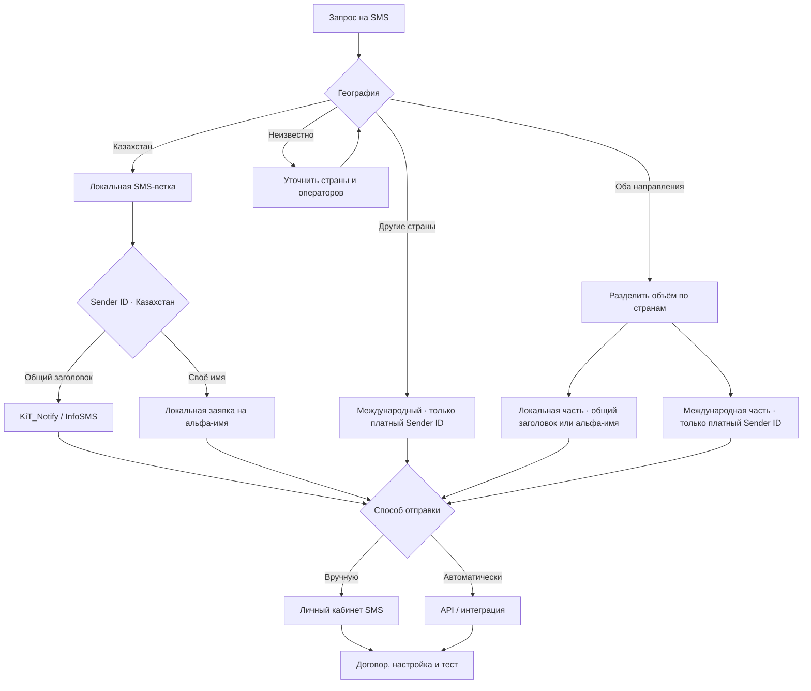

#### Вопросы менеджера

- «В какие страны и сети отправляете сообщения? Только Казахстан, другие страны или оба направления?»
- «Какие сообщения планируете отправлять: сервисные уведомления, коды, информационные или маркетинговые?»
- «Какой ориентировочный объём в месяц и какие ожидаются пики?»
- «Отправлять вручную из кабинета или автоматически из сайта, CRM, 1С либо приложения?»
- «Для SMS по Казахстану достаточно общего заголовка или хотите своё имя? Для других стран проверяется только платный Sender ID»
- «Пришлите пример сообщения без телефонов, кодов, паролей и других персональных данных. Если в тексте есть ссылка, в исходной инструкции указан домен `.kz`.»
- Для API: «Какую систему подключаем и есть ли у вашего технического специалиста предпочтение по протоколу?»

#### 1. Разделить локальный, международный и смешанный трафик

**Заметка менеджеру.** Географию определяйте по получателям и сетям, а не по регистрации компании. Условия SMS-источника не утверждены; спорную классификацию подтвердите у владельца.

**Скрипт для копирования:**

> В какие страны и сети вы планируете отправлять SMS: только Казахстан, другие страны или оба направления? Если направлений несколько, напишите их отдельно — я проверю требования для каждого.

- **Локальный, Казахстан:** в исходном документе отмечено обязательное подключение Beeline ID. Сообщите клиенту про общие имена и связанные с ними правила/штрафы, но сначала подтвердите действующие условия, перечень операторов и возможные платежи у владельца процесса. В документе этих критериев и сумм нет.
  - **Клиенту:** «Для отправки по Казахстану я проверю актуальные требования операторов, подходящие заголовки и условия. Пришлите, пожалуйста, список сетей и пример сообщения без номеров, кодов и персональных данных».
- **Международный:** только платный Sender ID. Общие заголовки KiT_Notify / InfoSMS и локальные альфа-имена не применяются. Проверяйте наличие и цену по каждой стране и оператору.
  - **Клиенту:** «Для международных SMS используется только платный Sender ID. Напишите страны, операторов и примерный объём по каждому направлению — я проверю доступность и стоимость».
- **Смешанный:** разделите направления и объёмы. По Казахстану выберите общий заголовок или локальное альфа-имя; за рубежом используйте только платный Sender ID. Не переносите локальные правила на международную часть.
  - **Клиенту:** «Поскольку отправка будет и по Казахстану, и за рубеж, давайте разделим направления. Пришлите страны и примерный объём для каждого — я проверю условия отдельно».
- **Неизвестный:** выясните страны назначения и пример сообщения. Не определяйте тип трафика по регистрации компании.
  - **Клиенту:** «Чтобы правильно определить настройки SMS, подскажите, где находятся получатели и через какие сети будете отправлять сообщения? Если пока не знаете, мы уточним это до настройки».

#### 2. Выбрать Sender ID для SMS по Казахстану

**Заметка менеджеру.** Эта развилка относится только к локальному трафику. Для международных SMS общих заголовков и альфа-имён нет — предлагайте только платный Sender ID. Не обещайте доступность, стоимость или срок без проверки и не отправляйте пример mysite.kz как клиентский домен.

**Скрипт для копирования:**

> Для SMS по Казахстану можно проверить общий заголовок или подать заявку на своё альфа-имя. Какой вариант вам подходит? Для отправки в другие страны проверю только платный Sender ID по требованиям операторов.

- **Общий заголовок · Казахстан:** исходный документ перечисляет KiT_Notify и InfoSMS. Для международного трафика эти имена не используются. При отправке от InfoSMS каждое сообщение должно позволять определить компанию по бренду, сайту или сервису. Не используйте обезличенный текст только с кодом или скидкой. Перед запуском проверьте действующие правила операторов и допустимость ссылки в тексте.
  - **Клиенту:** «Для общего заголовка пришлите название бренда или сайта, которое должно быть понятно получателю, и пример текста без персональных данных. Я сверю формат и действующие требования операторов».
- В образце SMS приведён [домен mysite.kz](http://mysite.kz) только как пример формата. Не копируйте его клиенту; в сообщение ставьте только согласованный домен клиента.
- **Уникальное альфа-имя · Казахстан:** имя — латинские буквы и цифры, максимум 11 символов; пробел считается символом, спецсимволы и эмодзи не допускаются. Передайте клиенту [форму заявки на альфа-имя](https://kazinfoteh.app.n8n.cloud/webhook/form/alpha-names), объясните требования и направьте заявку на согласование в [Telegram-чат альфа-имён](https://t.me/+M-sSoVpnkIFlNGUy). В форме согласования указывают действие, тип трафика, операторов и дату. Эта форма описывает локальное альфа-имя и не применяется для международного платного Sender ID. Не обещайте одобрение или срок.
  - **Клиенту:** «Если хотите своё имя отправителя, проверьте формат: до 11 символов, латинские буквы и цифры; пробел считается символом, эмодзи и спецсимволы не допускаются. Заполните [форму заявки](https://kazinfoteh.app.n8n.cloud/webhook/form/alpha-names). Я направлю её на согласование и сообщу статус; одобрение и срок заранее не гарантирую».
- **Клиент ещё выбирает:** сравните общий заголовок и альфа-имя здесь же, после ответа выберите подходящий путь. Отдельный узел сравнения не нужен. Если клиент просит исключение — согласуйте его со специалистом.
  - **Клиенту:** «Можно проверить общий заголовок или подать заявку на индивидуальное имя. Что для вас важнее: быстрее проверить доступный общий вариант или использовать название своего бренда? Я уточню условия выбранного варианта».

После согласования альфа-имени запросите счёт в [бухгалтерском чате](https://kazinfoteh.bitrix24.ru/online/?IM_CODE=GPb7AT7c8bA3wiZL) и отправьте клиенту полученный PDF. Суммы и примеры счетов из исходного файла не переносите: стоимость и период проверяйте по действующему прайсу.

#### 3. Выбрать способ отправки SMS

**Заметка менеджеру.** Зафиксируйте ручную отправку из кабинета или автоматизацию. Настройку пользователя выполняйте после договора; API/интеграцию предварительно проверьте со специалистом. Не принимайте пароли, коды и токены.

**Если нужен кабинет, отправьте:**

> Для ручной отправки после оформления мы подготовим доступ к SMS-кабинету. Вот [ссылка на кабинет SMS](http://isms.center/ru/app/auth) и [видеоуроки](https://www.youtube.com/playlist?list=PLLHZnBE-vL3xam0rem3CF2j4o0kSNJrbZ). Доступ передадим утверждённым безопасным способом. Пароль и коды подтверждения в чат не отправляйте.

**Если нужна интеграция, отправьте:**

> Для автоматической отправки передайте, пожалуйста, вашему техническому специалисту [API-документацию](http://api.kazinfoteh.org/). Уточните, какая система и протокол используются и какое событие должно запускать сообщение. Пароли, коды и API-токены в переписке не нужны; после согласования технического сценария мы передадим запрос специалисту.

#### 4. Подготовить договор

**Заметка менеджеру.** Собирайте реквизиты через утверждённую форму, проверьте документ и передавайте его только по внутреннему порядку. Не используйте персональные данные из образца.

**Скрипт для клиента:**

> Для подготовки договора заполните, пожалуйста, [ссылка на утверждённую форму реквизитов]. Когда документ будет готов, я проверю его и согласую удобный для вас способ подписания: ЭЦП, бумажный оригинал или PDF-скан — в рамках действующего порядка.

Соберите реквизиты компании: полное/сокращённое наименование, БИН, юридический и фактический адреса, ИИК, банк, БИК, КБЕ, телефон, email, ФИО директора и основание полномочий. Заполните [форму реквизитов](https://kazinfoteh.app.n8n.cloud/webhook/contract-autofill), выберите договор SMS, проверьте сформированный файл и скачайте договор через [Telegram-бот договоров](https://t.me/contract_autofill_kazinfoteh) или корпоративную папку договоров.

Передайте номер договора и нужные реквизиты в [бухгалтерский чат](https://kazinfoteh.bitrix24.ru/online/?IM_CODE=GPb7AT7c8bA3wiZL) для внесения в 1С. Отправьте договор клиенту и уточните способ подписи:

- Бумажные оригиналы — согласуйте передачу почтой или водителем; для Алматы заполните внутреннюю заявку на доставку.
- ЭЦП через [УчетЭДО](https://edo.uchet.kz/) — для загрузки договора передайте в [активный чат](https://kazinfoteh.bitrix24.ru/online/?IM_CODE=ogQtMMajfPIk5awl) БИН, корпоративный email и файл договора. Не добавляйте лишние персональные данные.

В исходном файле есть [пример договора](https://docs.google.com/document/d/1_E7u3xcZFZ1tg9_vqVXaDJM2iz0jhzX0win0M_I9YX4) с данными клиента. Открывайте его только при наличии доступа и деловой необходимости; не копируйте эти реквизиты в карточки или шаблоны.

#### 5. Подготовить кабинет или интеграцию после договора

**Заметка менеджеру.** Создание пользователя и изменение настроек выполняет уполномоченный сотрудник после оформления. Для API передайте технический сценарий специалисту утверждённым способом.

**Если клиент отправляет вручную из личного кабинета:** после договора и по действующему внутреннему порядку уполномоченный сотрудник создаёт пользователя в SMS-админке. Заполняет компанию по договору, источник, ответственного менеджера и тип доступа. Отметка «тестовый» в исходном документе связана с отсутствием бонуса менеджеру — правило требует подтверждения, не сообщайте его клиенту как условие услуги.

Далее в настройках SMS включают SMS и SMS-рассылки, снимают ненужные операторские отметки и выбирают тип трафика. Для Казахстана добавляют подтверждённый общий заголовок или локальное альфа-имя. Для международного трафика используют только платный Sender ID; общие заголовки и альфа-имена не добавляют. Beeline ID и BLOCKBEELINE применяйте только по подтверждённой локальной конфигурации. На скриншоте видна кнопка сохранения пароля в файл — не сохраняйте секрет локально, если это прямо не предусмотрено утверждённым защищённым процессом.

**Если нужна автоматическая отправка:** отправьте [API-документацию](http://api.kazinfoteh.org/) техническому специалисту клиента и попросите выбрать подходящий протокол (в исходной анкете перечислены SMPP, HTTP, SOAP, XML, JSON и Битрикс24). Клиент заполняет все поля анкеты юрлица: названия, БИН, регистрацию, вид деятельности/бренд, сайт, представительства, дочерние компании/франшизу, желаемый Sender ID по маршруту, образец SMS, протокол, тип сообщений и дату. Название сервиса для общего заголовка заполняйте только для локального SMS по Казахстану. После получения подписанной анкеты передайте запрос на создание интеграции в [SMS-техчат](https://kazinfoteh.bitrix24.ru/online/?IM_CODE=7z6HEDnvYFT11uzz).

Не переносите в рабочие материалы пример логина/пароля из исходного документа. Выдачу и передачу созданных доступов выполняйте только по утверждённому защищённому процессу. Отправьте клиенту ссылку на [личный кабинет SMS](http://isms.center/ru/app/auth), [видеоуроки по кабинету](https://www.youtube.com/playlist?list=PLLHZnBE-vL3xam0rem3CF2j4o0kSNJrbZ) и API-документацию, если она нужна.

#### 6. Тест, счёт и пополнение баланса

**Заметка менеджеру.** Применяйте действующие условия теста и прайс. Не используйте тарифные числа со скриншотов; фиксируйте результат теста и причину ошибки без секретов.

**Скрипт для клиента:**

> Перед запуском проверим согласованный тестовый сценарий и актуальные условия. После подтверждения результата я направлю счёт по действующему прайсу и подскажу, как проверить поступление оплаты и результат отправки.

Если тест нужен — примените действующие условия тестового доступа; проверьте источник, менеджера, права и безопасный способ входа. Перед отправкой проведите согласованный тест без реальных паролей, кодов или лишних данных. После подтверждения настройки выставьте счёт по актуальному прайсу и отправьте клиенту PDF.

Пополнение выполняется по выбранному способу: для личного кабинета — в разделе SMS-рассылок; для интеграции — на странице SMS-рассылок через интеграцию. Уточните поступление средств и результат тестовой отправки. При ошибке зафиксируйте страну, оператора, тип трафика, заголовок и текст ошибки без секретов и передайте специалисту.

#### Скриншоты из исходного DOCX

Снимки перенесены без изменений. На части скриншотов видны таблицы тарифов; числа на них не являются актуальным прайсом и не являются действующими тарифами и не должны использоваться для расчётов. Откройте изображение, чтобы увеличить.

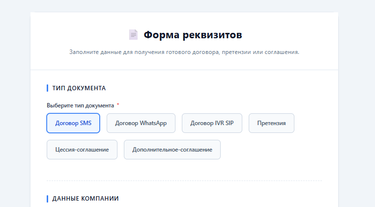

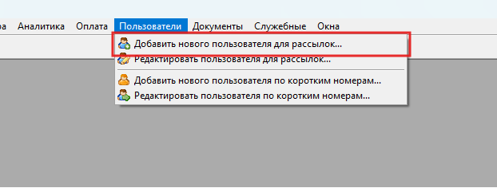

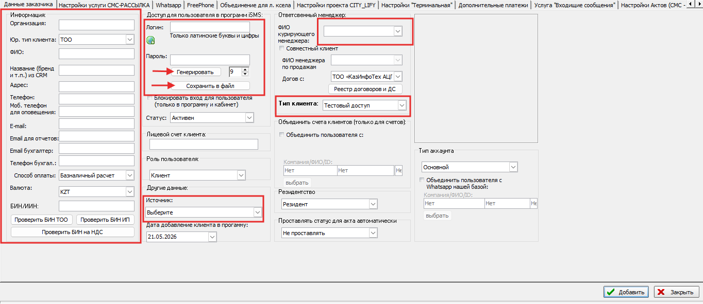

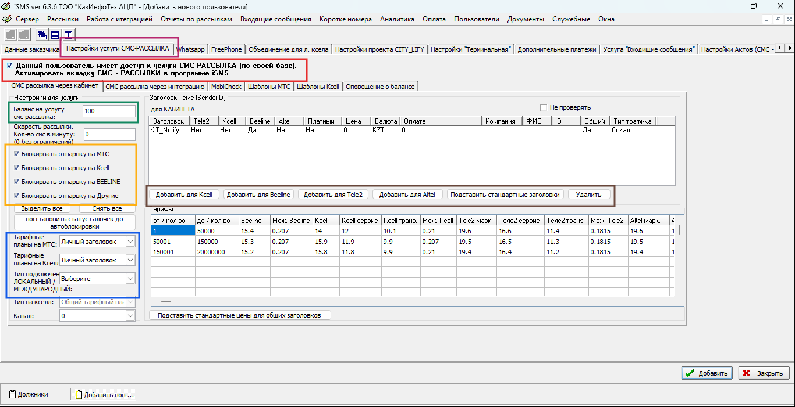

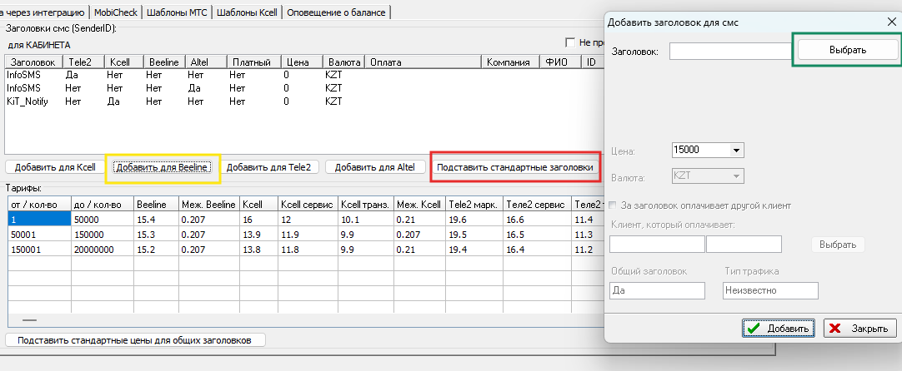

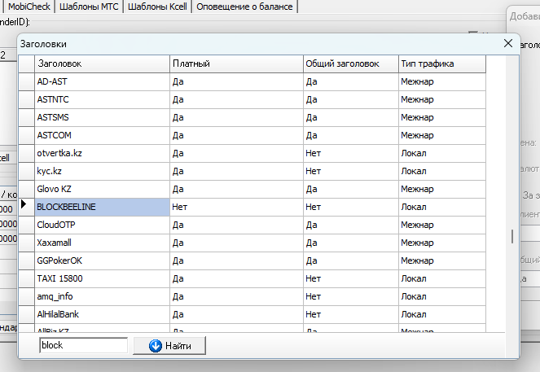

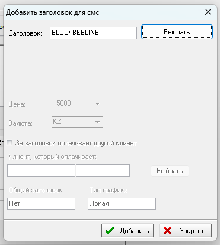

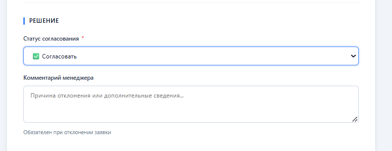

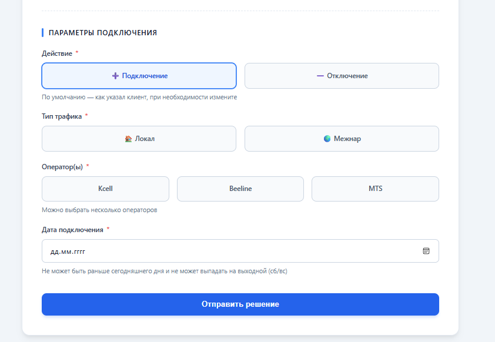

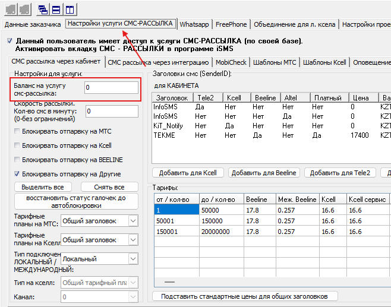

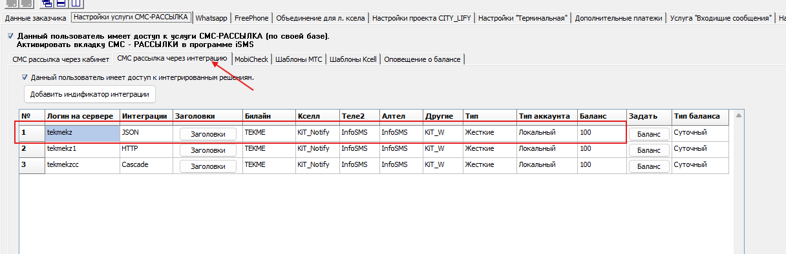

**Источник SMS-ветки:** локальный документ [алгоритм смс.docx](алгоритм%20смс.docx), статуса утверждения нет. Условия локального трафика, общих имён, альфа-имени, тестового доступа и счетов подтвердить у владельца процесса. Международное правило из уточнения владельца: общих заголовков и альфа-имён нет, доступен только платный Sender ID; проверять его по стране и оператору.

## 7. Активация и закрытие обращения

**Заметка менеджеру.** После успешного теста согласуйте дату первой боевой отправки. Проверьте результат через 1, 7 и 30 дней; при необходимости обсудите второй канал или новый сценарий. Затем зафиксируйте итог, ответственного, срок открытых задач и результат для клиента. Для незакрытого вопроса назначьте дату следующего обновления. Все действия собраны в одном завершающем узле.

В завершающем узле записать в CRM: клиента/контакт, задачу и канал, маршрут, подтверждённые условия и открытые вопросы, статус теста/договора, дату первой боевой отправки, контрольные касания 1/7/30 дней, передачу инструкции безопасным способом, результат проверки или ответственного специалиста и дату проверки, согласие получателей перед рассылкой, итог и следующий шаг.

- Всё выполнено и результат сообщён клиенту → закрыть.
- Есть открытая задача и назначены ответственный и дата → оставить в ожидающем статусе по CRM-регламенту.
- Нет владельца, даты, маршрута или результата специалиста → не закрывать; зафиксировать GAP и назначить следующий шаг.

**Скрипт клиенту при завершении:**

> Подтверждаю итог: [результат]. Следующий шаг — [действие и ответственный] до [дата/время]. Если появится вопрос или результат будет отличаться от ожидаемого, ответьте на это сообщение — я помогу продолжить.

**Завершение:** один из исходов выше записан в CRM.

**Источники:** [Скрипты](https://app.notion.com/p/400488a74e6c81758d41e1804efadee5), [iWabaKit — Заметки](https://app.notion.com/p/40c488a74e6c81c7a682dbce5cb47911), [Bitrix24 CRM](https://app.notion.com/p/a8a3fc0eb8224640a615a06a5c69b770). **Уверенность:** ≥2 по фиксации результата/согласия; статус закрытия CRM — один источник/подтверждение владельца.

## Системы и изображения

CRM и системы: [Bitrix24 CRM](https://app.notion.com/p/a8a3fc0eb8224640a615a06a5c69b770), [Внутренние системы](https://app.notion.com/p/e32258c228cc4faab1dcc642284f28a4), [Кабинеты](https://app.notion.com/p/4ab2385fd48449faafe7e9239700775a), [API — ссылки](https://app.notion.com/p/41f0863e21d44fd9998d19e2a8e2e3d9), [Справочник документов](https://app.notion.com/p/3e9488a74e6c8091a6abeb0579e97e2e). Для договора: [форма реквизитов](https://kazinfoteh.app.n8n.cloud/webhook/contract-autofill) и [папка договоров](https://drive.google.com/drive/folders/1p8Tpu3wDcZ9wzrjXN7U5o3QehUtWrTx6?usp=sharing). Внутренние чаты из доски: [активный чат / ЭДО](https://kazinfoteh.bitrix24.ru/online/?IM_DIALOG=chat12301), [подключение WhatsApp](https://kazinfoteh.bitrix24.ru/online/?IM_DIALOG=chat17315), [технические вопросы](https://kazinfoteh.bitrix24.ru/online/?IM_DIALOG=chat2374). Ссылка на [FlowZap](https://cabinet.flowzap.pro/) и [официальную инструкцию подключения](https://flowzap.pro/help-center/article/how-to-connect-official-whatsapp) указана в исходной доске. Проверьте доступность/актуальность внутренних ссылок перед отправкой клиенту; в чаты не передавайте пароли, коды и токены.

Для будущего дерева сохранять отдельные цветовые категории SMS, WhatsApp/iWabaKiT и FlowZap, видимые на исходной доске; подходящие изображения лежат в папке «скриншоты». Точные цвета интерфейса здесь не назначаются.

